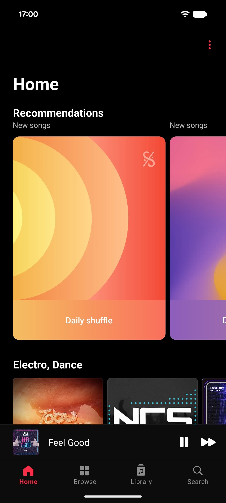
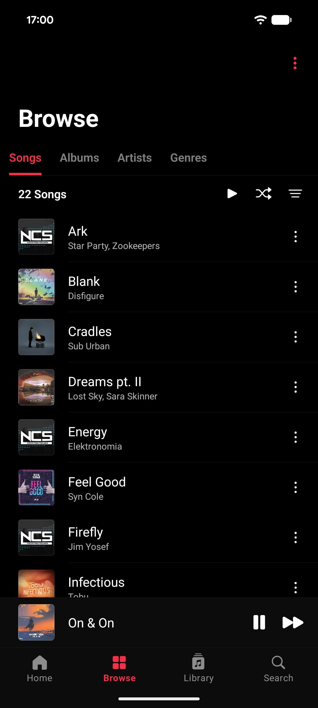
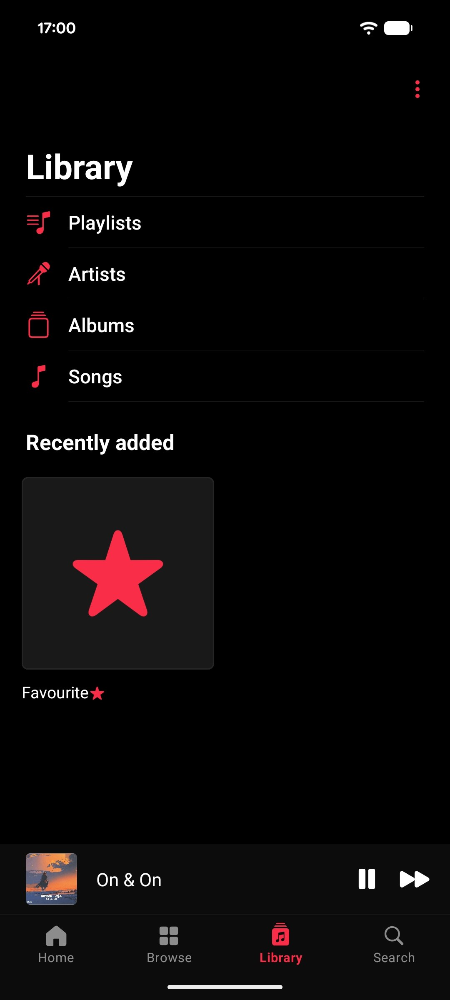
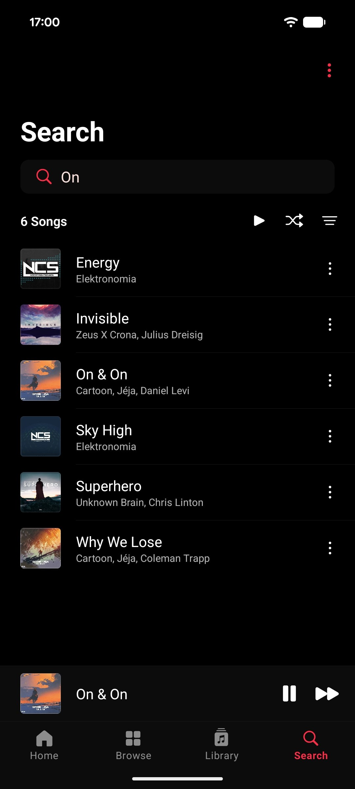
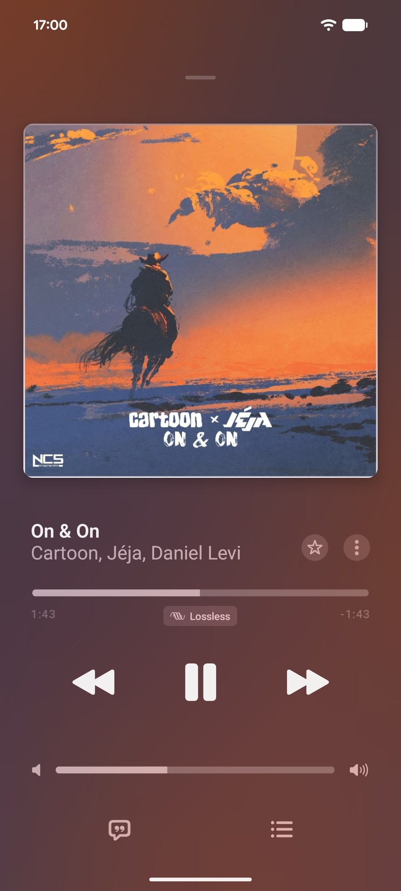
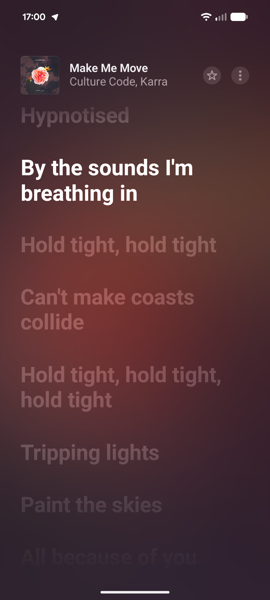

# Accord X

A sleek, lightweight local music player for Android with an Apple-inspired fluid design and Material You aesthetics. Powered by Media3 ExoPlayer with FFmpeg audio decoding for high-fidelity playback.

Fork of [Accord](https://github.com/PhantomFoundation/Accord) / [Gramophone](https://github.com/PhantomTan/Gramophone) with modern updates, bug fixes, automated folder playlists, and enhanced stability.

---

## ✨ Features

- 🎵 **High-Fidelity Audio Engine**: Built on AndroidX Media3 (ExoPlayer) with an integrated FFmpeg audio decoder supporting lossless codecs (`.flac`, `.alac`, `.wav`), `.opus`, `.ogg`, `.m4a`, `.aac`, `.mp3`, and `.midi`.
- 🖼️ **Accurate In-Memory Album Art**: Direct embedded picture extraction via `MediaMetadataRetriever` in memory—no duplicate disk cache files or conflicting `.thumbnail` folder clutter.
- 📁 **Automated Folder Playlists**: Scans your music directory structure into playlists automatically. No manual playlist creation or file-moving required.
- 🎤 **Synchronized Lyrics**: Real-time synced lyrics with LRCLIB and Paxsenix online integration alongside local `.lrc` file detection.
- 🎨 **Fluid Apple-Inspired Design**: Dynamic blur background, edge-to-edge layouts, adaptive Material You colors, and an intuitive full-height player bottom sheet.
- 📋 **Queue Management**: Full queue control with "Play Next", "Add to Queue", and instant "Clear Queue".
- 🎚️ **System Equalizer Support**: Seamlessly triggers your device's built-in audio effects or DSP control panel with the active audio session ID.
- 💾 **Playlist & Settings Backup**: Export and import playlists and app configurations to standard JSON format in your Documents directory.
- ⏱️ **Sleep Timer**: Built-in sleep timer to automatically pause playback after a set duration.

---

## 📱 Screenshots

<p align="center">
  
  &nbsp;&nbsp;
  
  &nbsp;&nbsp;
  
</p>
<p align="center">
  
  &nbsp;&nbsp;
  
  &nbsp;&nbsp;
  
</p>

---

## 🚀 What's New in v1.5

- **Accurate Album Art Engine**: Completely fixed album art overlap issues across Browse and Playlist sections. Extracted embedded cover pictures are decoded cleanly in memory, while system `.thumbnail` caches are ignored.
- **Folder-Driven Auto Playlists**: Your existing music folders are automatically detected and synced as instant playlists with live filtering/search.
- **Streamlined Experience**: Removed redundant "Add to Playlist" file operations and legacy tag editors for a lighter, faster, and crash-proof app.
- **Queue Controls**: Quick access to "Play Next", "Add to Queue", and "Clear Queue" directly from song menus and the now playing sheet.
- **Edge-to-Edge & Scroll Fixes**: Resolved playlist nested scrolling bugs, AppBar collapsibility, and proper padding across all navigation and status bar insets.
- **Equalizer Routing**: Fixed audio session ID passing to system equalizers and external DSP apps.
- **Reliable Daily Shuffle**: The homepage recommendations carousel intelligently samples from your local library so it never appears empty.

---

## 📥 Installation

Download the latest release APK from [GitHub Releases](https://github.com/PhantomCodeGhost/Accord-X/releases/latest).

---

## 🛠️ Building from Source

Requires **Android Studio Ladybug (or newer)** and **JDK 17**.

```bash
git clone https://github.com/PhantomCodeGhost/Accord-X.git
cd Accord-X
./gradlew assembleRelease
```

The compiled APK will be located at:
```
app/build/outputs/apk/release/Accord-X-1.5-release.apk
```

---

## 👥 Credits

- Based on [Gramophone](https://github.com/PhantomTan/Gramophone) by **PhantomTan** and [Accord](https://github.com/PhantomFoundation/Accord) by **Phantom Foundation**.
- Developed and maintained by [@PhantomCodeGhost](https://github.com/PhantomCodeGhost).

---

## 📄 License

Accord X is licensed under the **GNU General Public License v3.0 (GPL-3.0)**. See the [LICENSE](LICENSE) file for more details.
